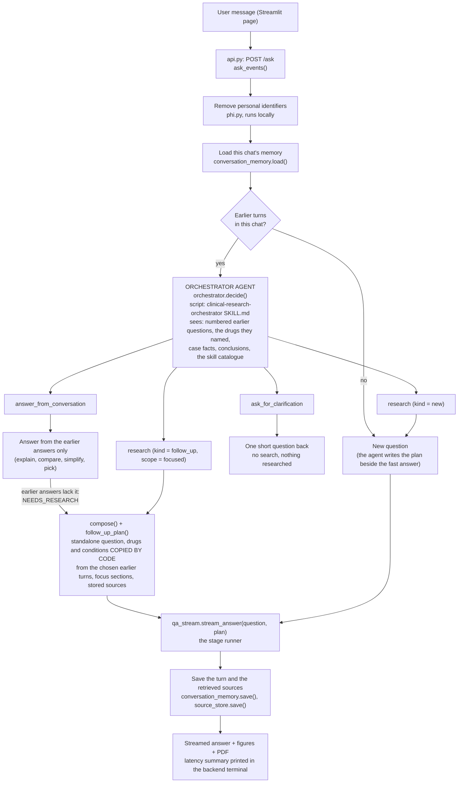
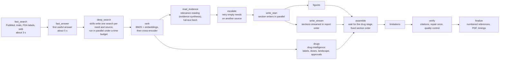
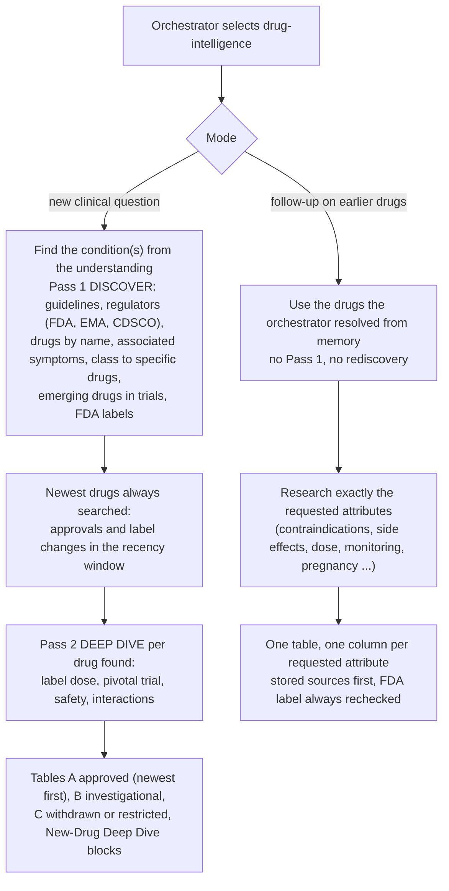
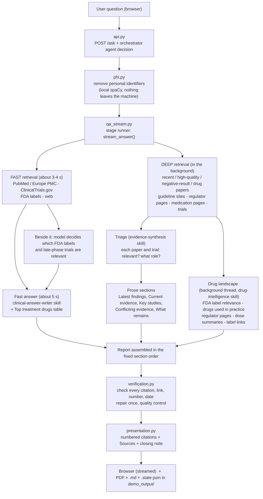
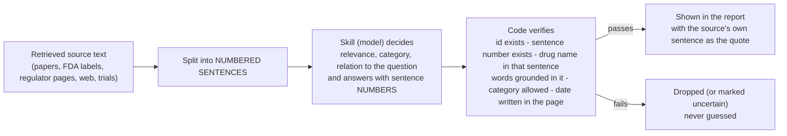

# NeuroGPT - clinical research agent

NeuroGPT answers a clinical or medical research question with a **sourced, structured report**, shown in the browser as it is being written and saved as a **PDF**.

A single **orchestrator agent** reads each message together with the chat's memory and decides whether to research it, answer it from the conversation, or ask back; follow-up questions get only the part they ask for.

It searches PubMed / Europe PMC, ClinicalTrials.gov, FDA drug labels (openFDA / DailyMed), regulator pages, guideline pages and the web. For the deep search a model first **understands the question and splits it into needs**, skills write one search per need and source, and the results are **ranked** (BM25 + embeddings + a cross-encoder). Language-model **skills interpret** what was retrieved, and **deterministic code verifies** every interpretation against the original source text before anything reaches the report.

> **Research support, not medical advice.** The report summarises retrieved sources and links to them. It is not a substitute for clinical judgement, and it is not a complete safety review.

---

## Contents

1. [What you get](#what-you-get)
   - [What the orchestrator is in this project](#what-the-orchestrator-is-in-this-project) (orchestrator flow, follow-ups, stage runner, drug skill, latency)
2. [How it works (flow diagrams)](#how-it-works)
3. [What the model does and what the code does](#what-the-model-does-and-what-the-code-does)
4. [How a model answer is verified](#how-a-model-answer-is-verified)
5. [Deep search: question understanding and routing](#deep-search-question-understanding-and-routing)
6. [Ranking: hybrid search and cross-encoder](#ranking-hybrid-search-and-cross-encoder)
7. [Project structure](#project-structure)
8. [Setup](#setup)
9. [Environment variables (`.env`)](#environment-variables-env)
10. [Run it](#run-it)
11. [Outputs and API](#outputs-and-api)
12. [Tests and audit](#tests-and-audit)
13. [Speed: what the latency depends on](#speed-what-the-latency-depends-on)
14. [Privacy](#privacy)
15. [Known limits](#known-limits)

---

## What you get

Ask a question in the browser (for example *"How to treat autism in children?"*). The answer is streamed in this fixed order, and the PDF has exactly the same sections:

| # | Section | Content | Written by |
|---|---|---|---|
| 1 | **Clinical summary** | Bottom line, most important recent finding, immediate context, then a **Top treatment drugs** table (established FDA-labelled drugs first, then the most notable latest investigational drug). Shown in about 5 seconds. | Model text + code-built table |
| 2 | **Latest findings** | Up to 4 dated bullets. A date later than the search date is shown as "Advance publication (issue dated ...)". | Model, checked by code |
| 3 | **Current evidence** | Table: approach, evidence level, what the evidence shows, reference. | Model, checked by code |
| 4 | **Treatment Drug Landscape** | *Drugs used for treatment of this condition* (FDA-labelled / guideline), *Other drugs: used for symptoms*, *Recently approved or updated (FDA, EMA and CDSCO announcements)*, *Safety warnings (FDA boxed warnings)*. | Code-built from sources; the model only decides relevance and shortens dose text |
| 5 | **Clinical trials** | Registered treatment trials with phase, status and last update, from ClinicalTrials.gov. | Code (registry facts) + model relevance decision |
| 6 | **Key studies** | Numbered studies with author, year, design, finding, PMID. | Model, incomplete entries removed by code |
| 7 | **Conflicting evidence** | Real disagreement between sources, or "none retrieved". | Model |
| 8 | **What remains under investigation** | Short bullets. | Model |
| 9 | **Evidence limitations** | Which sources failed, what was excluded, what is not known. Failed sources are never reported as "no evidence". | Code |
| 10 | **Sources** | Numbered list; every `[n]` in the report points to it. | Code |

---

## What the orchestrator is in this project

NeuroGPT is **one agent system with one controller**. Everything else is a tool, a skill file or plain code.

| Piece | What it is | File |
|---|---|---|
| **The orchestrator agent** | The only decision-maker. One [Agno](https://github.com/agno-agi/agno) agent call per message. Its script is the `SKILL.md` of the orchestrator. It *chooses*; it never writes drugs, evidence or numbers. | `orchestrator.py` + `skills/clinical-research-orchestrator/SKILL.md` |
| **Its three tools** | `research` (new question or follow-up, plus the plan), `answer_from_conversation` (no search), `ask_for_clarification` (one short question back). Each tool only *records* the choice. | `orchestrator.make_tools()` |
| **The stage runner** | Code that executes the choice: 14 named stages (fast search, fast answer, deep search, rank, drugs, writing, verify ...). The orchestrator chooses the stage order; `stages.py` checks it. | `qa_stream.py` (`stream_answer`), `stages.py` |
| **Skills** | Instruction files (`SKILL.md`) loaded as the system prompt of individual model calls (query writing, triage, drug reading, writing, verification). A skill is not an agent and never calls another skill. | `skills/*/SKILL.md` |
| **Conversation memory** | What each chat has already said: questions, drugs, case facts, conclusions, retrieved sources. It resolves references such as "both" or "the above"; it is never treated as clinical evidence. | `conversation_memory.py`, `source_store.py` |
| **Verification** | Code that checks every citation, number, date and link against what was retrieved. | `verification.py`, `landscape.py` |

So the "research agent" you run is the whole system; the **orchestrator** is the agent inside it that decides *what to do with each message*, and the rest of the code does the work it chose. If the agent fails or times out, the older JSON router and planner take over, so a message is never lost (`ORCHESTRATOR_AGENT=off` turns the agent off).

### Orchestrator flow (one message)



### How a follow-up is handled

The agent reads the message **by meaning**, not by trigger words. For every message it decides:

1. **Relation** - same patient or case, same drugs, same condition from a new angle, evidence behind an earlier statement, or a different subject. One sentence in `relation`.
2. **Which earlier question and which entities** - "both", "the above", "the first one" are resolved to a specific earlier turn; `turns` lists the numbers. "The above" means the most recent turn unless the message names another one. "Both" means the drugs the earlier question *named*, then the drugs its answer listed. Genuinely ambiguous: `ask_for_clarification`.
3. **What is asked NOW** - the intent is classified again for every message (a follow-up never inherits the previous intent). `info_needed` holds only what the message needs; `attributes` holds specific facts about the earlier drugs (for example contraindications, pregnancy, monitoring).
4. **Is the existing evidence enough?** Sufficient: `answer_from_conversation`. Insufficient: `research(kind=follow_up, scope=focused)`, which researches only the missing part and starts from the stored sources.

Code then does the safe part: the drugs and conditions are copied from the stored turns (the model never writes them), the case facts of the earlier question are added, and `focus_sections` maps the ask to what is researched and written (`drugs`, `safety`, `drug_facts`, `trials`, `evidence`). A focused answer prints only what was asked.

| Memory layer | What it holds | Where |
|---|---|---|
| Conversation history | The messages exchanged | Sent by the page; `turns_from_history` can rebuild turns |
| Turn summaries | Per turn: `summary`, `conclusions` | `conversation_history/memory/<chat id>.json` |
| Structured memory | Per turn: condition, `drugs`, `asked_drugs`, case facts, `follow_up` flag | the same file (`turn_from_final`) |
| Research evidence | Papers, trials, web results the earlier questions retrieved (FDA label records are deliberately not reused) | `conversation_history/sources/<chat id>.json` (`source_store`) |

An earlier AI answer is **never** treated as verified evidence: a conversational answer may only explain or reformat it, and every new clinical claim needs its own retrieved source and citation.

### The stage runner (what `stream_answer` executes)

The orchestrator writes the order of these stages in the same call that writes the plan; `stages.clean_order` fixes any order that breaks a dependency, and the default order is used when nothing usable is returned.



A **focused** follow-up runs the same machinery but researches and writes only the asked part (for example one table of contraindications built from the FDA label text and papers), and starts from the sources already stored for the chat.

A follow-up that asks for **the drugs of the condition** (for example "give me more drugs for the above question") is not about the drugs the earlier answer listed, so the orchestrator sets `needs_drugs=false` and `medicines_needed=true`. The program then discovers the condition's medicines afresh, newest ones included, and shows only the drug tables (the `drug_discovery` focus). The earlier drugs are copied from memory only when the message is about them (their dose, harms, contraindications, use for another condition).

### The drug skill: two modes

`skills/drug-intelligence/SKILL.md` is chosen for **every new clinical question**, whatever its intent, because the medicines of the condition are shown beside every answer.



In both modes every dose, adverse effect, contraindication, approval status and number comes from a retrieved source, never from the model's memory.

### Latency observability

One run is a chain of model calls, retrievals, tool executions and orchestration stages, and each is recorded as a span (`observability.py`; no outside service needed).

- **Backend terminal:** a `[step]` line for every finished model call, tool call and stage, then a `[latency]` summary (model / tool / orchestration-and-wait time, slowest stages, per-model first-token time and tokens per second, slowest tools, errors, retries, input size).
- **Browser:** `http://127.0.0.1:8000/latency` shows p50 / p95 / p99 tables over the recorded runs, per-stage and per-tool times, the model calls of one run with their input size (context growth) and a waterfall. `/latency/summary` returns the same numbers as JSON.
- **Files:** `python latency_report.py` prints the tables and writes `observability/latency_report.html`; `observability/runs.jsonl` holds one line per run. `latency_benchmark.py` runs a set of questions for the percentiles.
- **Switches:** `OBSERVABILITY=off`, `OBSERVABILITY_PRINT=off` (summary), `OBSERVABILITY_STEPS=off` (step lines).

---

## How it works

### Overall flow (plain-text version, shows in any viewer)

```text
 USER QUESTION (browser)
        |
        v
 api.py  --  POST /ask   (conversation memory + orchestrator agent decide how the message is handled)
        |
        v
 phi.py  --  remove personal identifiers (local spaCy; nothing leaves the machine)
        |
        v
 qa_stream.py  --  stage runner  stream_answer()  (executes what the orchestrator chose)
        |
        +--------------------------------------+---------------------------------------------+
        |                                      |                                             |
        v                                      v                                             v
 FAST RETRIEVAL (about 3 s)             DEEP RETRIEVAL (background)                  Model decides which FDA labels
 PubMed / Europe PMC                    recent / quality / negative-result /         and late-phase trials are relevant
 ClinicalTrials.gov                     drug papers, guideline sites,                (runs beside the fast answer)
 FDA labels, web                        regulator pages, medication pages, trials               |
        |                                      |                                                |
        v                                      |                                                |
 FAST ANSWER (about 5 s)  <-----------------------------------------------------------------+
 clinical-answer-writer skill
 + "Top treatment drugs" table
        |                                      |
        |                          +-----------+----------------------+
        |                          |                                  |
        |                          v                                  v
        |                 TRIAGE (evidence-synthesis)        DRUG LANDSCAPE (background thread, drug-intelligence)
        |                 each paper / trial: relevant?      FDA label relevance, drugs used in practice,
        |                 what evidence role?                regulator pages, dose summaries, label links
        |                          |                                  |
        |                          v                                  |
        |                 PROSE SECTIONS                              |
        |                 Latest findings, Current evidence,          |
        |                 Key studies, Conflicting evidence,          |
        |                 What remains under investigation            |
        |                          |                                  |
        +--------------------------+----------------------------------+
                                   |
                                   v
                 REPORT ASSEMBLED in the fixed section order
                                   |
                                   v
                 verification.py  --  check every citation, link, number and date;
                                      repair once; quality control
                                   |
                                   v
                 presentation.py  --  numbered citations [n], Sources list, closing note
                                   |
                                   v
                 BROWSER (streamed)  +  PDF, .md and .state.json in demo_output/
```

### Overall flow (diagram; GitHub draws it, VS Code needs a Mermaid extension)



### Timeline of one question (typical, varies with the outside services)

```text
 0 s   question received, personal identifiers removed
 3 s   fast retrieval done (PubMed/Europe PMC, trials, FDA labels, web)
 5 s   FIRST USEFUL ANSWER: Clinical summary text; Top treatment drugs table follows within a few seconds
10 s   deep retrieval done; triage of every paper and trial starts (2-3 s)
12 s   Latest findings start streaming (the other prose parts are already being written in parallel)
22 s   Treatment Drug Landscape appears (it was built in the background)
28 s   Key studies ... Evidence limitations; verification; final report + PDF
```

### The model reads, the code checks



---

## What the model does and what the code does

**Design rule:** retrieval finds, skills interpret, code verifies. No clinical meaning is hard-coded: there are no rules such as "if the text contains *approved* then it is an approval", and nothing is specific to any disease or drug. The fixed things are the contracts: schemas, allowed categories, verification checks, source allow-lists and the report structure.

| Step | Skill file loaded (system prompt) | Receives | Returns |
|---|---|---|---|
| Understand the question | `clinical-research-orchestrator` | The question and the skill catalogue | Intent, condition, the information needed (treatment options, safety, dosing, ...), which skills should write searches |
| Write the deep searches | `latest-evidence`, `drug-intelligence`, `clinical-trials` (section "Query transformation by intent") | The question, its intent and what was understood | One search per need and source: `target`, query, arguments, priority |
| Fast answer | `clinical-answer-writer` | A few papers, trials, web items, FDA label indications | Bottom line, recent finding, context |
| Paper and trial triage | `evidence-synthesis` | Every retrieved paper / registry record as numbered sentences | Relevance, evidence role, supporting sentence number |
| Latest findings ... What remains | `evidence-synthesis` | The papers the triage judged relevant, with their roles and dates | The prose sections, written by **three calls side by side** (Latest findings / Current evidence / Key studies + Conflicting evidence + What remains), shown in the document's order |
| FDA label relevance | `drug-intelligence` | Each label's indication as numbered sentences | Relevant or not, relation to the condition, sentence number |
| Drugs used in practice | `drug-intelligence` | Sources in groups of four, as numbered sentences | Drug, kind (generic / brand / class), statement type, category, sentence number |
| Regulator pages | `drug-intelligence` | Page text as numbered sentences | Approval / label update / safety communication / other / not relevant, relation, sentence numbers |
| Dose summary | `drug-intelligence` | The label's dosing section | 3-4 plain sentences (numbers checked against the label) |

All JSON-reading calls run at **temperature 0**, so the same input gives the same decision.

**Code only (no model):** retrieval, the FDA drug tables (indication text, label date, route, DailyMed links), boxed warnings in the label's own words, the trials table, evidence limitations, citation numbering, the Sources list, PDF rendering.

**Skills in `skills/`:** nine `SKILL.md` files (orchestrator, latest-evidence, drug-intelligence, clinical-trials, evidence-synthesis, citation-verification, clinical-answer-writer, quality-control, figure-selection). The orchestrator, clinical-answer-writer, evidence-synthesis, drug-intelligence and figure-selection files, and the "Query transformation by intent" sections of latest-evidence, drug-intelligence and clinical-trials, are sent to the model as instructions. Citation verification and quality control are done by code and kept as written contracts.

---

## How a model answer is verified

Every model decision must point back to retrieved evidence, and code checks it:

- the **source id** exists and the **sentence number** exists in that source;
- the **drug name** is in the sentence it points at, and the name is one specific drug (a drug class is rejected; a brand is shown with the generic name read from its FDA label);
- the **indication / population words** are grounded in that sentence (otherwise the model's wording is not shown and the sentence speaks for itself);
- the **category** is one of the fixed values, and "Guideline-recommended" needs a page of an organisation in `config/care_topics.json`;
- a **date** is shown only if it is written in the page text (the page itself is read for its date); announcements are listed as recent only if dated within 3 years of the search date;
- a **dose** is shown only from the FDA label, and every number in a model summary must appear in the label text;
- trial phase, status and dates come only from the registry record;
- every **PMID, DOI, NCT id and link** in the final report must exist in what was retrieved; unretrieved ones are removed;
- wording checks: overclaims ("proven", "confirmed"), "established" without a guideline, dose-response wording, claims about trials without posted results;
- a finding **dated after the search date** is shown as an advance publication.

If a source fails or times out, the report says so. It never turns a failed search into "no evidence exists".

---

## Deep search: question understanding and routing

The fast search (about 3 s, six searches) is fixed and never changed by anything below. The deep search is model-driven:

1. **Plan call** (`plan_with_skill`, temperature 0, started after the first token of the fast answer): intent, condition, patient group, the *information needed* (for example `treatment_options`, `efficacy`, `safety`, `dosing`, `guideline_recommendation`, `regulatory_status`, `trial_status`) and the skills proposed.
2. **Skill selection** (`retrieval_routing.select_skills`): the proposal is checked against the catalogue; a skill is added when its `covers:` line (in its `SKILL.md` front matter) matches an information need nobody covers.
3. **Query transformation**: each chosen skill writes JSON `{"queries": [{need_id, need, serves, target, query, args, priority, alternate?}]}` (an empty list is allowed). Each query has exactly one `target`: `pubmed`, `europepmc`, `guideline_sites`, `regulator`, `fda_label`, `web` or `trials`. An essential need gets a query for every source that can answer it.
4. **Validation in code** (`parse_operations`): the target must be on the allowlist, the query must keep the question's own subject words, a drug may be named only if the question names it, arguments are clamped, duplicates and near-duplicates are merged.
5. **Coverage check** (`coverage_gaps`, data in `config/source_capabilities.json`): finds an information need with no search on a suitable source, a treatment question without a guideline or regulator search, too few web-discovery searches, or an essential need served by one source only. One bounded model call writes the missing searches; they are validated the same way.
6. **Run** in parallel under a time budget, one retry for transient errors, late results recorded. The older ("legacy") deep jobs run beside them as the baseline (`ENABLE_LEGACY_SEARCH=false` skips them), and everything is merged into one set (by PMID, then DOI, then title; each record keeps every search that found it). If the routing fails, the legacy results still make the report and the limitations say "Deep routing unavailable; results use the standard search only." Each run logs, per search, its mode, source, records returned and records the other mode did not find, and ends with a one-line summary (`state["search_log"]`).
7. **Escalation**: a need that returned nothing, or nothing relevant after the relevance reading, is retried once on an alternate source (at most 4 retries, one hard deadline). Unfinished work is listed in the limitations.
8. **Section states**: a report section with no content says why (not applicable / not retrieved / no relevant evidence / failed / timed out); a failed or unsearched source is never reported as "no evidence".

The `target` names, arguments and thresholds are data and contracts; no disease, drug or population is named in code (a test scans for that).

---

## Ranking: hybrid search and cross-encoder

The sources do the retrieving (PubMed matches words in titles, abstracts and index terms; the others use their own search). `hybrid_search.py` then ranks what came back; it cannot find a paper a source did not return, and there is no vector database (embeddings are made per run and discarded).

| Step | Method | Model / library |
|---|---|---|
| Keyword | BM25 over every returned paper | Plain Python |
| Semantic | Question and papers embedded, compared by meaning | `mistral-embed` (Mistral API; `EMBED_MODEL` overrides) |
| Fusion | Reciprocal rank fusion of the two rankings and the sources' own order | Plain Python |
| Cross-encoder | The top 36 papers re-scored by reading the question and each paper's title and abstract start together; the score is fused with the hybrid position | `Xenova/ms-marco-MiniLM-L-6-v2`, run locally with `fastembed` (ONNX, no GPU); `CROSS_ENCODER_MODEL` overrides |

The cross-encoder also screens web, guideline and regulator results with a threshold; borderline results are left to the model-based relevance reading. Each stage switches itself off, and says why in the trace, when disabled, with fewer than three papers, or when the model is not ready in time.

**Passages (chunks).** The abstract of each of the best-ranked papers (and the full-text sections read below) is cut into short passages. The same local cross-encoder scores every passage against the question, in the background beside the relevance reading, and the writer is shown each paper's best passages (3 by default) with only the start of its abstract (`chunking.py`; `CHUNKING=off` to disable, `CHUNKS_PER_PAPER` to change). Passages are pieces of the paper's own text, so verification still finds every number. If the model is not ready, the writer gets the abstract as before.

**Full text.** After ranking, the top 6 papers with a free full text (a PubMed Central ID in the open-access subset) have their methods, results and conclusion fetched in the background (`fulltext.py`, 6 s limit) and shown to the writer beside the abstract. Numbers from those sections count as retrieved text in verification. Other papers stay abstract-only; searching itself is still on titles and abstracts.

---

## Project structure

```text
.
├── streamlit_app.py     Chat front end (Streamlit): stages, streamed answer, figures inside their sections, PDF download
├── api.py               Backend (FastAPI, port 8000): POST /ask (NDJSON stream), /pdf, /file, /health, /latency, /latency/summary
├── orchestrator.py      The orchestrator AGENT: one Agno agent call per message (tools: research, answer_from_conversation, ask_for_clarification); follow_up_plan, focus_sections
├── conversation_memory.py  Per-chat memory: turns, drugs, case facts, conclusions; reference resolution (compose), conversational answers
├── source_store.py      Per-chat store of retrieved papers, trials and web results, reused by follow-ups
├── stages.py            The 14 named stages of a run and the rules for their order
├── qa_stream.py         The stage runner: stream_answer() runs retrieval, skills, ranking, drugs, writing, assembly, verification; also a command-line runner
├── safety_answer.py     Focused drug-fact tables (side effects, contraindications, any requested attribute) from FDA label text and papers
├── observability.py     Latency tracing: spans for model calls, tools and stages; console lines, runs.jsonl
├── latency_report.py    Percentile tables (p50/p95/p99) and waterfall (terminal, HTML, /latency)
├── latency_benchmark.py Runs a set of questions to collect latency runs
├── conditions.py, quick_check.py, drug_handoff.py, medication_assessment.py, recovery.py, plan_audit.py   Condition matching, quick drug/condition check, drug transfer between skills, medication assessment, recovery, plan audit
├── server.py            Older local API server (port 8000, same port as api.py: do not run both): /api/chat-stream, /api/chat
├── clinical_tools.py    Retrieval tools: PubMed / Europe PMC, ClinicalTrials.gov, openFDA labels + DailyMed links, page dates
├── landscape.py         Drug landscape, regulator announcements, boxed warnings, trials table, limitations; verification of model decisions
├── verification.py      Citation / claim / number / date verification, one repair pass, quality control
├── report.py            Key-studies helpers
├── presentation.py      Numbered citations [n], Sources list, closing note
├── guidelines.py        Guideline-site search (domains and topics come from config/care_topics.json)
├── phi.py               Personal-identifier scrubbing (local spaCy model + rules)
├── pdf_export.py        Markdown -> PDF (reportlab); this is where heading levels and tables are styled
├── pipeline.py          save_pdf / strip_preliminary (plus an older single-pass pipeline kept for reference)
├── audit.py             Independent audit script for a saved report (32 checks)
├── retrieval_routing.py Source-aware deep-search routing: validated operations (a `target` from a fixed allowlist), the seven search adapters, retry and time budget, coverage check, escalation, section states
├── hybrid_search.py     BM25 + embedding ranking (RRF) and the cross-encoder re-ranking
├── chunking.py          Passage (chunk) ranking with the cross-encoder; the writer sees each paper's best passages
├── fulltext.py          Methods, results and conclusion of the best open-access papers (read after ranking)
├── source_figures.py    Original figures of cited open-access papers (caption, licence, selection)
├── tracing.py           Optional LangSmith tracing of model calls and tools
├── config/care_topics.json         Authoritative guideline domains and search topics
├── config/source_capabilities.json What each search target can answer and the minimum searches for treatment questions (data only)
├── .streamlit/config.toml          Streamlit theme and server settings
├── skills/              The nine SKILL.md contracts (+ skills/README.md); the orchestrator's SKILL.md is the agent's script
├── observability/       Latency records (runs.jsonl, latency_report.html), created at run time
├── tests/               Offline unit tests (no network or model needed) and a PHI-miss report script
├── demo_output/         Saved reports: <slug>.md, <slug>.pdf, <slug>.state.json (cli_test_runs/ for command-line runs)
├── requirements.txt     Python dependencies
└── .env.example         Template for your keys (copy to .env)
```

`conversation_history/` is created at run time (a Markdown log per browser conversation with personal identifiers removed, plus `memory/` and `sources/` for follow-ups). It is not needed to produce a report and is ignored by git. `observability/` and `backups/` are local working folders and are ignored by git too.

---

## Setup

Requirements: **Python 3.10 or newer** (developed and tested on 3.13) and internet access.

```powershell
# 1. create and activate a virtual environment (Windows PowerShell)
python -m venv .venv
.\.venv\Scripts\Activate.ps1

# 2. install the dependencies (includes the spaCy English model used for name removal)
python -m pip install -r requirements.txt

# 3. create your .env from the template and put in your keys
copy .env.example .env
```

On macOS / Linux: `python3 -m venv .venv && source .venv/bin/activate`, then the same `pip install` and `cp .env.example .env`.

**Always start the server with the project's Python** (`.venv`). A global Python without these packages fails with errors such as "`mistralai` not installed".

---

## Environment variables (`.env`)

Never commit `.env`; `.gitignore` already excludes it. Copy `.env.example` and fill in your own keys.

| Variable | Needed? | Meaning |
|---|---|---|
| `MODEL_PROVIDER` | yes | `mistral` or `groq`. Chooses the language model provider. |
| `MISTRAL_API_KEY` | if `mistral` | Key from the Mistral console. |
| `MISTRAL_MODEL` | if `mistral` | Default Mistral model for every stage. Use `mistral-medium-latest` for clinical planning and screening. |
| `MISTRAL_REASONING_MODEL` | optional | Overrides the model for question planning, source-query decisions, label decisions and evidence triage. Defaults to `MISTRAL_MODEL`. |
| `MISTRAL_WRITER_MODEL` | optional | Overrides the model that writes the streamed FAST and DEEP report prose. Defaults to `MISTRAL_MODEL`; set a smaller Mistral model only after evaluating output quality. |
| `GROQ_API_KEY` | if `groq` | Key from Groq. |
| `GROQ_MODEL` | optional | Default `openai/gpt-oss-120b`. |
| `MODEL_TIMEOUT_S` | optional | A model call with no answer after this many seconds fails instead of hanging the report (default 30). |
| `TAVILY_API_KEY` | recommended | Main web search (regulator, guideline and medication pages). Without it, or when the plan limit is reached, the slower, less reliable DDGS search is used and the drug and regulator parts get fewer sources. One question uses roughly 10 searches. |
| `NCBI_API_KEY` | recommended | Free key that raises PubMed's rate limit from about 3 to 10 requests a second. Get it at ncbi.nlm.nih.gov -> account -> Account settings -> API Key Management. |
| `NEUROGPT_NO_BROWSER` | optional | Set to `1` to stop the server opening your browser on start. |
| `HYBRID_SEARCH`, `CROSS_ENCODER` | optional | `off` turns the hybrid ranking or the cross-encoder off (default on). `EMBED_MODEL` and `CROSS_ENCODER_MODEL` change the models. |
| `ENABLE_DEEP_ROUTING` | optional | `false` turns the model-written, source-aware deep searches off (default on; the older `DEEP_ROUTING=off` and `QUERY_EXPANSION=off` still work when this is not set). |
| `ENABLE_LEGACY_SEARCH` | optional | `false` skips the older fixed deep searches (default on; the older `LEGACY_DEEP=off` still works when this is not set). |
| `ENABLE_MESH_EXPANSION` | optional | `false` stops the deep PubMed / Europe PMC searches (legacy and routed) from adding the MeSH vocabulary's heading and entry terms for the condition words (default on; looked-up terms are kept in `cache/mesh_terms.json`). `MESH_TIMEOUT_S` (3) and `MESH_ROUTING_WAIT_S` (1.5) bound the lookups. |
| `ENABLE_SIMILAR_ARTICLES` | optional | `false` stops PubMed's "similar articles" of the five papers most searches returned from being added to the evidence (default on). |
| `ROUTING_MAX_QUERIES` / `ROUTING_MAX_COVERAGE_ADDITIONS` | optional | The most routed searches per question (default 14) and the most the coverage check adds (default 4). |
| `RATE_<SOURCE>_PER_S` | optional | Requests per second to `PUBMED`, `EUROPEPMC`, `CLINICALTRIALS`, `FDA` or `TAVILY`, shared by both modes (PubMed: 2.5 without an NCBI key, 8 with one, under NCBI's 3 and 10). |
| `PLANNER_PROVIDER` / `PLANNER_MODEL` | optional | Provider and model of the plan call only (for example `groq` and `qwen/qwen3.8-27b`); the routed search calls stay on the Mistral model. |
| `ROUTING_DEADLINE_S`, `ROUTING_BUDGET_S`, `ESCALATION_DEADLINE_S` | optional | Hard time limits in seconds for the routed searches (defaults 55, 18, 25). |
| `COVERAGE_CHECK`, `COVERAGE_CALL_S` | optional | `off` skips the coverage check; the time its one model call may take (default 8). |
| `SCREEN_THRESHOLD`, `SCREEN_MARGIN` | optional | Cross-encoder screen for web results (defaults -8 and 2). |
| `FULL_TEXT`, `FULL_TEXT_PAPERS`, `FULL_TEXT_WAIT_S` | optional | Full-text sections of the best open-access papers: on/off, how many papers (6), time limit (6 s). |
| `FIGURE_IMAGE_CHECK`, `VISION_PROVIDER`, `VISION_MODEL` | optional | Whether a vision model must confirm figure images (default off). |
| `ORCHESTRATOR_AGENT`, `ORCHESTRATOR_PLANS`, `ORCHESTRATOR_TIMEOUT_S` | optional | `off` turns the orchestrator agent (or its plan writing) off, falling back to the JSON router and the planner call; the agent's time limit in seconds (default 20). |
| `OBSERVABILITY`, `OBSERVABILITY_PRINT`, `OBSERVABILITY_STEPS` | optional | `off` stops latency tracing, the per-run summary printed in the backend terminal, or the per-step lines (all default on). |
| `FAST_TOKENS` | optional | Length limit (tokens) of the first, fast answer. Default 800; raise it if a first answer is cut off mid-sentence. |
| `EARLY_LATEST`, `DRUG_STAGE_EARLY`, `CHAT_CONTEXT_CHARS` | optional | Start the Latest findings from the ranked papers early; start the drug stage early; how much of the earlier answers a conversational answer may read. |
| `LANGSMITH_TRACING`, `LANGSMITH_API_KEY`, `LANGSMITH_PROJECT` | optional | LangSmith tracing (default off). When on, questions, abstracts and prompts are sent to LangSmith. |

No key is needed for ClinicalTrials.gov, openFDA, DailyMed, Europe PMC or the local name detector.

---

## Run it

```powershell
.\.venv\Scripts\streamlit.exe run streamlit_app.py --server.port 8501
```

Open `http://localhost:8501`, type a clinical question and watch the stages (Fast answer -> Evidence -> Drugs -> Trials -> Verification -> Final). Figures from open-access papers appear inside their report sections, and the PDF can be downloaded. Stop it with `Ctrl+C`.

The page needs the backend: start it in a second terminal with `.\.venv\Scripts\uvicorn.exe api:app --host 127.0.0.1 --port 8000` (or double-click `start_backend.bat` and `start_frontend.bat`). Then open `http://127.0.0.1:8000/latency` to see the latency of the agent's workflow. The older `server.py` uses the same port: do not run both.

Command-line run (writes to `demo_output/cli_test_runs/`, so it never overwrites a browser answer):

```powershell
.\.venv\Scripts\python.exe qa_stream.py "How to treat autism in children?"
```

---

## Outputs and API

Each browser question saves three files in `demo_output/`, named from the question (`how-to-treat-autism-in-children.*`):

- `.pdf` - the report (same sections and order as on screen)
- `.md` - the same report as Markdown
- `.state.json` - everything retrieved and every model decision (what was offered, what was accepted or rejected and why, timings), for audit

**Endpoint:** `POST /api/chat-stream` with `{"messages": [{"role": "user", "content": "..."}], "conversation_id": "..."}`. It streams newline-delimited JSON events:

| Event `type` | Meaning |
|---|---|
| `stage` | A stage began: `INITIAL`, `EVIDENCE_ENRICHING`, `DRUGS_ENRICHING`, `TRIALS_ENRICHING`, `VERIFICATION`, `FINAL` |
| `token` | A piece of report text to append |
| `milestone` | Timing marks such as `first_useful_answer` |
| `warning`, `error` | A problem the reader should know about |
| `verification` | Verification result and what was repaired |
| `final` | The complete verified Markdown, timings and state |
| `pdf` | Where the PDF was saved |

`POST /api/chat` returns the same final report in one response (for old clients).

**Current backend (`api.py`):** `POST /ask` with `{"question": "...", "conversation_id": "...", "history": [...]}` streams the same kind of events plus `scrubbed` (the question with identifiers removed), `understood` (how the orchestrator read the message: the standalone question and the earlier turns it used), `preface` (a short grounded answer for an "also used for another condition?" follow-up) and `figures`. Other routes: `GET /pdf/{name}`, `GET /file?path=`, `GET /health`, `GET /latency` (HTML report), `GET /latency/summary` (JSON).

---

## Tests and audit

```powershell
# unit tests: no network, no model, about 10 seconds
.\.venv\Scripts\python.exe -m unittest discover -s tests -t .

# independent check of a saved report (reads demo_output/<slug>.md and .state.json)
.\.venv\Scripts\python.exe audit.py how-to-treat-autism-in-children

# which person names the local detector misses (known limits)
.\.venv\Scripts\python.exe tests\phi_misses.py
```

The suite has more than 800 tests. They cover routing and query validation, the search adapters, escalation, the coverage check, section states, source families, guideline migration, full-text reading, verification of model decisions (quotes, sentence numbers, categories, dates), report structure and heading order, citation numbering, regulator classification, trial relevance, personal-identifier removal and the PDF-facing text.

---

## Speed: what the latency depends on

The first useful answer takes about 5 seconds. With the routed deep search the whole report took roughly 45-65 seconds in recent runs (the earlier 25-35 s was before it). The time depends on:

- **the language model**: every written section and every decision call waits on it; a single call took 1-7 s and a stalled call can cost up to `MODEL_TIMEOUT_S`;
- **the search services**: Europe PMC varied between 2 and 14 s, and web search falls back to a slow engine when the Tavily key is out of quota;
- **the deep search**: the plan call, then the skills writing queries (10-12 s for the slowest), the coverage check (about 3 s), the searches, and the legacy jobs running beside them (up to 25 s); the phase ends with the slower of the two;
- **the number of steps that must run in order**: retrieval -> fast answer -> triage -> prose. Everything else (drug landscape, regulator reading, label lookups, dose summaries) runs in parallel in a background thread.

Built-in protections: the fast pass waits at most 4.5 s per source; Europe PMC has a PubMed fallback; the triage is waited for at most 3.5 s; label lookups and dose summaries get at most 4 s; results are cached for repeated questions.

---

## Privacy

Before anything is searched, sent to a model or saved, `phi.py` removes names, IDs, dates of birth, phone numbers, e-mail addresses and street addresses from the question. It keeps age, sex, conditions, drugs, doses and lab values. Detection runs **locally** (spaCy plus rules). The scrubbed question is what goes to the model provider, PubMed, the web search and the conversation log. Detection is not perfect; `tests/phi_misses.py` lists known misses. Do not enter real patient identifiers.

---

## Known limits

- The model can still make mistakes that grounding cannot detect: for example calling a drug "used in practice" from a hedged sentence, or classifying an irrelevant regulator page as an action. Every shown item is grounded in a real sentence of its source, but a grounded sentence can be misread.
- The list of "other drugs" and regulator announcements varies between runs because web search returns different pages and the model's answers depend on them.
- For a very broad question (for example "cancer"), the FDA label search returns labels that mention the condition most often, so the approved-drug table can contain supportive-care drugs; the main cancer drugs then appear under "Other drugs" from web and regulator pages.
- Dose text is taken from the label section whose title names the condition; if none is found, the cell says so.
- PubMed "dates" for early online articles are the scheduled issue date; they are shown as advance publications when later than the search date.
- The semantic ranking re-orders what the sources return; it cannot retrieve a paper they did not return. Full text is read only for open-access papers; paywalled papers stay abstract-only.
- Regulator pages are found only through web search, so their coverage varies between runs.
- Search quality and speed depend on outside services (Mistral/Groq, Tavily, Europe PMC, NCBI, openFDA) and their rate limits.
- Not a medical device and not validated for clinical use.

## Front end and backend (separate programs)

The page and the research pipeline are two programs that talk over HTTP:

- **Backend** (`api.py`, FastAPI, port 8000): runs the pipeline. `POST /ask` streams the answer as NDJSON events (one JSON object per line: scrubbed, stage, token, warning, milestone, verification, final, figures, pdf, error); `GET /pdf/{name}`, `GET /file?path=` (figure images) and `GET /health`. The full research state stays on the server. Interactive docs: http://127.0.0.1:8000/docs
- **Front end** (`streamlit_app.py`, port 8501): sends the question and the earlier turns to `/ask` and draws the events. `NEUROGPT_API_URL` changes where it looks for the backend.

Start both (two terminals): `uvicorn api:app --host 127.0.0.1 --port 8000` and `streamlit run streamlit_app.py --server.port 8501`, or double-click `start_backend.bat` and `start_frontend.bat`. The older `server.py` uses the same port 8000: do not run both.

## Who decides the order of the steps

`skills/clinical-research-orchestrator/SKILL.md` describes the run as steps. `stages.py` offers them as named stages (fast_search, fast_answer, deep_search, rank, read_evidence, drugs, escalate,
write_start, figures, write_stream, assemble, limitations, verify, finalize). The orchestrator agent writes their order in the same call that writes the plan (`stages`); `stages.clean_order` checks it
(a stage never runs before the stages it reads; every required stage runs). Without a usable choice the default order is used. The order that ran is saved in `state["stage_order"]`.
